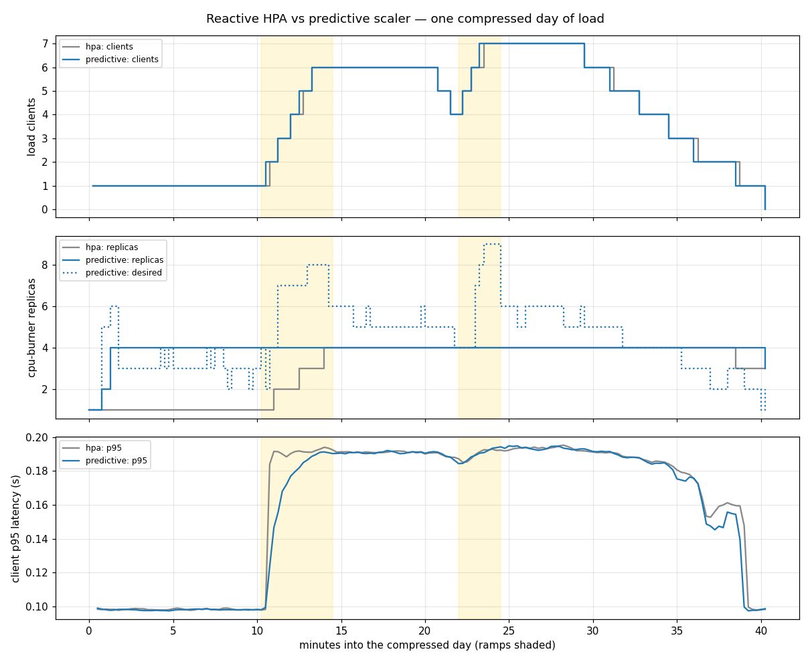

# Benchmark: predictive scaler vs reactive HPA

_Generated by `bench/report.py` from a run of `.github/workflows/benchmark.yml` (commit `27b0f28`, 2026-10-28); do not edit by hand. How it is measured: [bench/README.md](../bench/README.md)._

Same kind cluster, same cpu-burner workload (500m CPU per replica, up to 6 replicas), same compressed day of load (40 min per run): quiet night, sharp ramp at 06:00, lunch dip, second ramp at 13:00, evening decline. Run A scales with a plain CPU HPA at 70%; run B with the KEDA predictive scaler (`mode=max`, `forecastAggregation=max`, target 0.35 cores per replica, 30 s step) on a model trained on the warm-up days of the same pattern.

| Metric | A: reactive HPA | B: predictive | B vs A |
|---|---|---|---|
| p95 latency during ramps (mean of 1-min p95) | 184 ms | 176 ms | (−4% better) |
| p95 latency during ramps (worst minute) | 194 ms | 194 ms | (+0% worse) |
| p95 latency over the day (mean of 1-min p95) | 161 ms | 159 ms | (−2% better) |
| Requests slower than 500 ms | 0.00% | 0.00% | |
| Client errors (timeouts) | 0 of 48992.91 | 0 of 49776.46 | |
| Replica-minutes | 122.50 | 158.50 | (+29% worse) |
| Peak replicas | 4 | 4 | |
| Ramp 1 (06.0h): time to first scale-up | 45 s | n/a | |
| Ramp 2 (13.0h): time to first scale-up | n/a | n/a | |
| Scaler decisions from forecast / observed (run B) | — | 154 / n/a | |
| Forecast rolling MAE, step 1, end of run B (model units) | — | 0.023 | |

## Reading the numbers

- *Time to first scale-up* is measured from the moment the simulated clock enters the ramp to the first increase in running cpu-burner pods. The HPA reacts to CPU already above target; the predictive scaler reports `max(forecast, observed)`, so it can only be earlier when the model's forecast rises before the observed demand does.
- *Replica-minutes* are the cost side: a scaler that is early but over-provisions pays here.
- Both runs share one small node (the CI runner), so absolute latencies are noisy; the comparison between runs is the point, and it is one sample. The weekly run keeps the history in the workflow artifacts.
